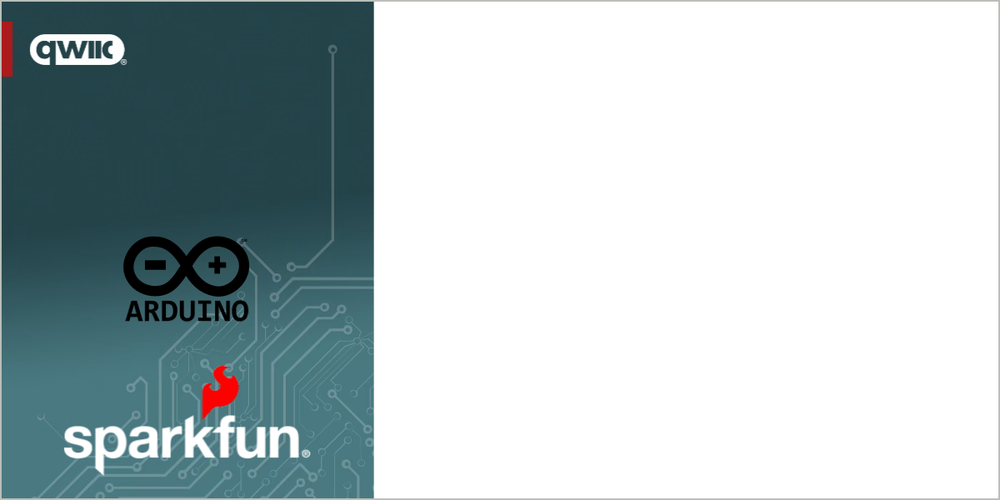

# SparkFun BMA456 Arduino Library

Arduino library for the SparkFun Qwiic BMA456 breakout, built around the Bosch BMA456 16-bit triaxial accelerometer.


[](https://github.com/sparkfun/SparkFun_BMA456_Arduino_Library/actions/workflows/cross-compilation.yml)


The BMA456 is a 2 x 2 mm, 16-bit triaxial accelerometer with a 1 kB FIFO, two interrupt pins,
and an on-chip feature engine that detects motion events without the host doing any work. It is
the successor to the BMA400 in Bosch's low-power accelerometer line, with 16-bit rather than
12-bit output and a much larger set of on-chip features - at the cost of a feature-engine
configuration file the host has to upload at start-up. This library does that upload for you.

This library allows you to:

* Read acceleration and a hardware timestamp in one transaction, plus die temperature
* Talk to the board over **I2C or SPI** with identical code above the bus layer
* Set output data rate, full-scale range, filtering and power mode
* Use **both interrupt pins**, with any source routed to either one independently
* Buffer samples in the **1 kB FIFO** with watermark and full interrupts
* Choose between two Bosch **feature sets** for the on-chip engine:
  * **BMA456H** - step counter, step detector, step activity (still / walking / running),
    single / double / triple tap, any-motion, no-motion, auto low power
  * **BMA456MM** - orientation, high-g (shock), low-g (free fall), significant motion,
    single / double / triple tap, any-motion, no-motion, auto low power
* Remap axes, run the **self-test**, and calibrate offsets with **fast offset compensation**

The library wraps Bosch's [BMA456 SensorAPI](https://github.com/boschsensortec/BMA456_SensorAPI)
the same way the [SparkFun BMA400 library](https://github.com/sparkfun/SparkFun_BMA400_Arduino_Library)
wraps Bosch's BMA400 API, and routes every bus transaction through the
[SparkFun Toolkit](https://github.com/sparkfun/SparkFun_Toolkit).

## Quick Start

```cpp
#include <SparkFun_BMA456.h>

SfeBMA456ArdI2C myAccel;

void setup()
{
    Serial.begin(115200);
    Wire.begin();
    Wire.setClock(400000);   // shortens the configuration upload in begin()

    while (myAccel.begin() == false)
    {
        Serial.println("BMA456 not found - check your wiring!");
        delay(1000);
    }
}

void loop()
{
    sfe_bma456_sensor_data_t data;
    myAccel.getSensorData(data);

    Serial.print(data.accel.x, 3);
    Serial.print(", ");
    Serial.print(data.accel.y, 3);
    Serial.print(", ");
    Serial.println(data.accel.z, 3);

    delay(100);
}
```

### Five things worth knowing up front

**Pick a feature set in `begin()`.** The feature engine runs one Bosch configuration at a time.
`begin()` with no arguments loads **BMA456H**. Pass `sfeBMA456FeaturesMM` for orientation, high-g,
low-g and significant motion, or `sfeBMA456FeaturesNone` for a plain accelerometer:

```cpp
myAccel.begin();                          // BMA456H - steps, activity, tap, motion
myAccel.begin(sfeBMA456FeaturesMM);       // BMA456MM - orientation, high/low-g, sig-motion, tap, motion
myAccel.begin(sfeBMA456FeaturesNone);     // no feature engine
```

Calling a feature the loaded set does not have - `getStepCount()` under MM, say - returns
`ksfBMA456ErrFeatureUnavailable` and changes nothing.

**Only the configuration you use is linked.** Each Bosch configuration is 6144 bytes. The one a
sketch names is the only one that ends up in flash; the other is discarded by the linker, and
`sfeBMA456FeaturesNone` drops both. On an Uno, Example 01 builds to about 20 kB with BMA456H and
Example 04 to about 14 kB with no feature engine.

**It runs on an ATmega328P.** Bosch's configuration loader streams the blob from RAM, and 6 kB of
`const` data would not fit in an AVR's 2 kB of SRAM. This library keeps the blob in `PROGMEM` and
uploads it 30 bytes at a time, which also keeps every transfer inside the 32-byte AVR Wire buffer.
Every example compiles for an Uno.

**`begin()` takes about 0.6 s at 400 kHz.** Most of it is the 450 µs gap the part needs after
every register write during the upload, plus the 140-150 ms the feature engine takes to boot.
At the default 100 kHz I2C clock it is about 1.1 s. `begin()` then leaves the accelerometer
running at its power-on configuration - 100 Hz, ±4 g, continuous filtering - as the BMA400
library does.

**The default I2C address is 0x18.** Close the board's ADR jumper for `0x19`.
`SfeBMA456ArdI2C::findDevice()` checks both and confirms the chip ID, so a sketch does not have to
know how the jumper is set.

## Hardware

### I2C (default)

Plug a Qwiic cable in.

| Breakout | Host        |
| -------- | ----------- |
| Qwiic    | Qwiic       |
| INT1     | any input pin (optional) |
| INT2     | any input pin (optional) |

### SPI

The SPI pins are broken out as well, and the same driver handles them.

| Breakout | Host           |
| -------- | -------------- |
| SDI      | COPI (MOSI)    |
| SDO      | CIPO (MISO)    |
| SCK      | SCK            |
| CS       | any output pin |
| 3V3      | 3V3            |
| GND      | GND            |

```cpp
SfeBMA456ArdSPI myAccel;
myAccel.begin(10);                          // chip select on D10, BMA456H
myAccel.begin(10, sfeBMA456FeaturesMM);     // chip select on D10, BMA456MM
```

The BMA456 powers up in I2C mode and switches to SPI on the first rising edge of CS, and every
SPI read returns one dummy byte ahead of the data. Both are handled inside the library.

### Interrupts

Both pins are brought out, and every source is routed independently:

```cpp
myAccel.mapInterrupt(BMA456_INT_SRC_ANY_MOTION, BMA456_INT1);   // motion on INT1
myAccel.mapInterrupt(BMA456_INT_SRC_NO_MOTION, BMA456_INT2);    // stillness on INT2
```

Unlike the pins, the interrupt **status** register is shared by both pins and is
**clear-on-read**. Call `getInterruptStatus()` once per event and test the whole returned word
against the `sfe_bma456_int_status_t` masks. The examples use latched mode
(`setInterruptLatch(true)`), which holds the pin asserted until that read - easier on an
edge-triggered ISR than a short pulse.

## Examples

| Example | What it covers | Feature set |
| ------- | -------------- | ----------- |
| [Example01_BasicReadingsI2C](examples/Example01_BasicReadingsI2C) | Acceleration and temperature over Qwiic | H |
| [Example02_BasicReadingsSPI](examples/Example02_BasicReadingsSPI) | The same sketch over SPI | H |
| [Example03_Interrupts](examples/Example03_Interrupts) | Data-ready interrupt, one read per sample, sensor-time intervals | H |
| [Example04_Filtering](examples/Example04_Filtering) | Continuous vs. averaging mode, with measured noise at each setting | None |
| [Example05_FIFOBuffer](examples/Example05_FIFOBuffer) | Watermark interrupt and burst reads of the FIFO | None |
| [Example06_MotionDetection](examples/Example06_MotionDetection) | Any-motion and no-motion on separate pins | H or MM |
| [Example07_OrientationChange](examples/Example07_OrientationChange) | Portrait / landscape / face up-down | MM |
| [Example08_TapDetection](examples/Example08_TapDetection) | Single, double and triple tap | H or MM |
| [Example09_StepCounterAndActivity](examples/Example09_StepCounterAndActivity) | Step count with a watermark interrupt, plus still / walking / running | H |
| [Example10_AutoLowPower](examples/Example10_AutoLowPower) | The feature engine managing power on its own | H or MM |
| [Example11_HighGLowG](examples/Example11_HighGLowG) | Shock and free-fall detection | MM |
| [Example12_SignificantMotion](examples/Example12_SignificantMotion) | Sustained movement, ignoring knocks | MM |
| [Example13_SelfTestAndCalibration](examples/Example13_SelfTestAndCalibration) | Electrostatic self-test, then fast offset compensation and saving the result | None |
| [Example14_AxisRemap](examples/Example14_AxisRemap) | Correcting a mounting orientation | H |

The set follows the SparkFun BMA400 library's examples where the two parts overlap, so most BMA400
sketches have a direct counterpart here.

## Key Specifications

From the [BMA456 datasheet](https://www.bosch-sensortec.com/media/boschsensortec/downloads/datasheets/bst-bma456-ds000.pdf):

| | |
| --- | --- |
| Range | ±2 / ±4 / ±8 / ±16 g, 16-bit (16384 / 8192 / 4096 / 2048 LSB/g) |
| Output data rate | 12.5 to 1600 Hz continuous, 0.78 to 400 Hz averaging (low power) |
| Noise density | 120 µg/√Hz |
| Zero-g offset | ±20 mg typical (±4 g range) |
| FIFO | 1024 bytes - 170 headerless frames |
| Sensor time | 24-bit, 39.0625 µs per LSB, wraps every 655.36 s |
| Temperature | 1 K/LSB, 0 = 23 °C, updated every 1.28 s |
| Supply | VDD 1.62-3.6 V, VDDIO 1.2-3.6 V |
| Current | 150 µA performance mode, 14 µA low power at 50 Hz, 3.5 µA suspend |
| Interfaces | I2C (0x18 / 0x19), SPI 3- and 4-wire |
| Chip ID | 0x16 |
| Package | 12-pin LGA, 2 x 2 x 0.65 mm |

## API Notes

### Units are the hardware's, not SI

Feature configuration structures carry the device's own units, because converting them would hide
the quantization:

| Field | Unit |
| ----- | ---- |
| Motion, low-g, high-g, sig-motion thresholds and hysteresis | 1/2048 g per LSB (0.488 mg) |
| Any/no-motion, low-g, sig-motion durations; auto low power time-out | 20 ms per LSB (the engine runs at 50 Hz) |
| High-g duration | 5 ms per LSB (evaluated at 200 Hz) |
| Step counter watermark | 20 steps per LSB |
| FIFO watermark | bytes - one frame is 6 bytes |
| User offsets | 3.9 mg per LSB, ±0.5 g |

The default values in the configuration structures are this library's suggestions, not the
device's power-on values. The examples start with `get...Config()`, change the fields they care
about, and write the structure back.

### Averaging mode caps the sample count by rate

In `BMA456_PERF_MODE_AVERAGING` the part averages N samples per output, and the higher the output
rate the fewer it has time for. `setAccelConfig()` rejects combinations above the cap:

| ODR | 0.78-6.25 Hz | 12.5 Hz | 25 Hz | 50 Hz | 100 Hz | 200 Hz | 400 Hz | 800, 1600 Hz |
| --- | --- | --- | --- | --- | --- | --- | --- | --- |
| Largest N | 128 | 64 | 32 | 16 | 8 | 4 | 2 | continuous mode only |

### Library bits, not register bits

The BMA456H and BMA456MM configurations put their feature enables and interrupt flags at
different bit positions - any-motion is bit 4 of `INT_STATUS_0` under H and bit 5 under MM. The
library's `sfe_bma456_feature_t`, `sfe_bma456_int_source_t` and `sfe_bma456_int_status_t` values
are the same under both, and the driver translates. A sketch written against one set runs
unchanged against the other for every feature they share.

Under BMA456MM, any-motion and no-motion have no enable bit - they run whenever at least one axis
is enabled in their configuration. `enableFeature(BMA456_FEAT_ANY_MOTION)` edits that axis field,
so the call looks the same under both sets.

### The FIFO is headerless

Every frame is six bytes - X, Y, Z - with no header, so `readFifoData()` reads whole frames in
fixed-size chunks and never splits one. Frames carry no timestamp: at a fixed ODR, frame *N* was
sampled *N* / ODR before the newest one.

### Axis remapping is applied on the host too

The BMA456 does not remap its data registers. `setAxisRemap()` writes the map into the feature
engine - so the features see the product's frame - and the library applies the same map to
`getSensorData()`, `getAccelData()` and FIFO frames, as Bosch's own `bma4_read_accel_xyz()` does.

### Self-test and reset clear your setup

`performSelfTest()` ends in a soft reset (Bosch's routine does one), so the library reloads the
feature configuration and restores the accelerometer settings. Enabled features, interrupt
routing, FIFO setup, axis remap and user offsets are gone and must be set up again. `softReset()`
has the same effect.

### Error handling

The examples ignore most return codes to stay short. Every method that touches the bus returns an
`sfTkError_t`: `ksfTkErrOk` (0) on success, a negative code otherwise. The codes worth knowing:

| Code | Meaning |
| ---- | ------- |
| `ksfTkErrOk` | Success. |
| `ksfTkErrBusNoResponse` | Nothing answered, or the chip ID was not 0x16. |
| `ksfBMA456ErrConfigLoad` | The feature-engine configuration did not start. The part still reads acceleration; no feature will respond. |
| `ksfBMA456ErrFeatureUnavailable` | The call needs a feature the loaded set does not have - `getStepCount()` with the MM set, say. Nothing was written. |
| `ksfBMA456ErrBosch` | The Bosch SensorAPI refused. `getLastBoschResult()` returns Bosch's own code (`BMA4_E_...` in `bma4_defs.h`). |
| `ksfTkErrInvalidParam` | An argument out of range. |

`begin()` on the Arduino class returns a `bool`; after a failure, `getInternalStatus()` reads the
feature engine's INTERNAL_STATUS register (`0x01` means the configuration started).

Some mistakes are not errors at the moment they happen. An ODR and averaging combination the part
cannot run is accepted by the register write and only shows up in ERR_REG, which
`getErrorStatus()` decodes - worth one call after any configuration change.

## Bosch SensorAPI

The `src/bma456_api` folder holds the parts of Bosch's
[BMA456 SensorAPI](https://github.com/boschsensortec/BMA456_SensorAPI) v2.29.0 this library uses
(`bma4`, `bma456h`, `bma456mm`), under its own BSD-3-Clause [license](src/bma456_api/LICENSE).
Four small changes were needed to run it on 8-bit AVR, one fixes a rounding error in the self-test, and a few Bosch calls with known problems
are replaced by, or wrapped in, the driver's own code - the temperature read, for one, reports
anything below 23 °C as 256 °C too hot, and the offset calibration needs 768 bytes of stack. All of it is listed in
[SPARKFUN_CHANGES.md](src/bma456_api/SPARKFUN_CHANGES.md).

## Repository Contents

* **/examples** - Example sketches for the library (.ino). Run these from the Arduino IDE.
* **/src** - Source files for the library (.cpp, .h).
* **/docs** - Configuration files for the documentation.
* **keywords.txt** - Keywords from this library that will be highlighted in the Arduino IDE.
* **library.properties** - General library properties for the Arduino package manager.

The library is in three layers. `src/bma456_api` is Bosch's SensorAPI. `src/sfTk/sfDevBMA456.{h,cpp}`
is a comms-agnostic driver that owns the Bosch device structure, supplies its bus callbacks through
the SparkFun Toolkit, and knows nothing about Arduino. `src/SparkFun_BMA456.h` supplies the Arduino
I2C and SPI wrappers. A sketch only ever needs the last.

## Documentation

* **[Library Documentation](https://docs.sparkfun.com/SparkFun_BMA456_Arduino_Library/)** - Arduino Library Documentation for this repository.
* **[Hookup Guide](https://docs.sparkfun.com)** - Hookup guide for the SparkFun Qwiic BMA456 breakout.
* **[Installing an Arduino Library Guide](https://learn.sparkfun.com/tutorials/installing-an-arduino-library)** - Basic information on how to install an Arduino library.
* **[SparkFun Toolkit](https://github.com/sparkfun/SparkFun_Toolkit)** - The bus abstraction this library is built on. Required.
* **[BMA456 Datasheet](https://www.bosch-sensortec.com/media/boschsensortec/downloads/datasheets/bst-bma456-ds000.pdf)** - Bosch Sensortec.
* **[Bosch BMA456 SensorAPI](https://github.com/boschsensortec/BMA456_SensorAPI)** - The vendor driver included in `src/bma456_api`.
* **[Hardware GitHub Repository](TODO)** - Main repository (including hardware files) for the product that uses this library.

## Products That Use This Library

* [[TODO: SKU]](https://www.sparkfun.com/) - SparkFun Triple Axis Accelerometer Breakout - BMA456 (Qwiic)

## License Information

This product is ***open source***!

This product is licensed using the [MIT Open Source License](https://opensource.org/license/mit)
